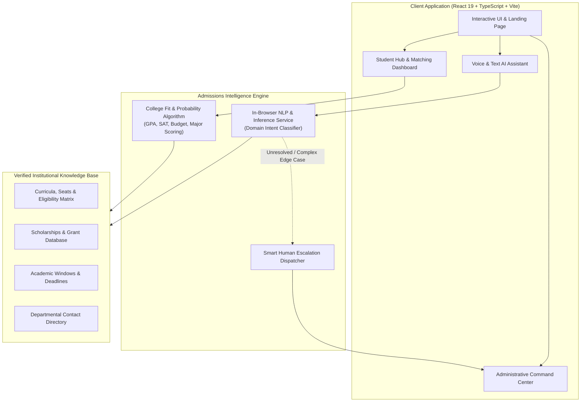

<div align="center">

# 🎓 AdmitAI (EduBugs)
### Next-Generation AI College Identification & Admissions Intelligence Platform

[](https://react.dev/)
[](https://www.typescriptlang.org/)
[](https://vitejs.dev/)
[](https://tailwindcss.com/)
[](https://opensource.org/licenses/MIT)
[](https://github.com/UNNIKUTTAN125/admitai-collegeidentifiaction_platform/pulls)

<p align="center">
  <b>Target the right institutions. Predict acceptance probabilities. Automate student inquiry resolution 24/7.</b>
</p>

[Explore Features](#-key-features) • [System Architecture](#-system-architecture) • [Getting Started](#-getting-started) • [Tech Stack](#-tech-stack) • [Live Demo](#-live-demo--preview)

---

</div>

## 📌 Executive Summary

Every year, millions of prospective students struggle through fragmented college prospectus booklets, overwhelmed campus phone lines, and opaque admissions criteria. At the same time, institutional admissions offices are inundated with thousands of repetitive inquiries during peak admission windows (July–September).

**AdmitAI (EduBugs)** solves both sides of this challenge through a unified, high-performance platform:
1. **For Students**: Delivers personalized college fit matching and realistic acceptance probability scores (Safe, Target, Reach) powered by GPA, test scores, intended majors, and tuition budget.
2. **For Institutions**: Deploys a sub-250ms conversational AI assistant grounded in official campus knowledge bases, providing 24/7 automated inquiry triage and smart human handoff to administrative departments.

---

## 🚀 Key Features

### 1. 🎯 Dynamic College Fit & Probability Matcher
- **Multi-Factor Scoring**: Evaluates student profile metrics (High School GPA, SAT/ACT scores, target degree, geographic preference, and annual budget).
- **Categorized Risk Tiers**: Transparently segments matching institutions into **Safe** (>80%), **Target** (60–80%), and **Reach** (<60%) admission brackets.
- **Tuition & Cost Breakdown**: Visualizes annual tuition, hostel fees, and net estimated costs side-by-side.

### 2. 💬 Conversational Admissions AI Assistant
- **Sub-250ms Instant Answers**: Real-time natural language query answering for program eligibility, scholarship deadlines, entrance exams, and campus life.
- **Voice Input & TTS Synthesis**: Multimodal voice interaction with speech-to-text recognition and natural audio playback.
- **Contextual Suggested Prompts**: Dynamic inquiry chips guiding students toward relevant questions without typing.

### 3. 📚 Institutional Knowledge Base Engine
- **Centralized Synchronized Source of Truth**: Structured indexing of accredited degrees (B.Tech, M.Tech, MBA, MCA, Ph.D.), seat matrix, annual fee schedules, and required application documents.
- **Scholarship Finder**: Filters merit-based, need-based, sports, and government grant schemes with eligibility criteria and application deadlines.
- **Important Dates Calendar**: Live tracking for admission windows, seat allocation rounds, and hostel registration.

### 4. 🔄 Smart Human Handoff Protocol
- **Automated Escalation Dispatch**: Intelligently identifies complex, sensitive, or disputed queries that require human expertise.
- **Departmental Routing**: Pre-populates inquiry context and automatically dispatches priority tickets directly to the Admissions & Enrolment Office, Financial Aid Bureau, or International Students Cell.

### 5. 🎓 Admission Offer Simulation & Fee Receipt Generator
- **Interactive Offer Simulation**: Generates verifiable digital admission letters with institutional seal, candidate application ID, and allotted program.
- **Payment Gateway Simulation**: End-to-end fee payment workflow with instant downloadable PDF-ready receipts and transaction verification.

### 6. 🛠️ Administrative Operations Dashboard
- **Inquiry Triage Analytics**: Real-time telemetry tracking query volumes, resolution rates (94%+ automated), and response latencies.
- **Knowledge Base Inspector**: Departmental staff can review, verify, and update curriculum requirements and fee notices on the fly.

---

## 🏛️ System Architecture



---

## 💻 Tech Stack

| Domain | Technology | Purpose |
| :--- | :--- | :--- |
| **Frontend Framework** | **React 19.2** | Component-driven reactive user interface |
| **Language** | **TypeScript 5.x** | Strict end-to-end type safety & interface contracts |
| **Build Tooling** | **Vite 8.x (Rolldown)** | Lightning-fast HMR and optimized production bundling |
| **Styling & Design** | **Tailwind CSS 3.4** | Modern responsive design system with custom brand palette |
| **Iconography** | **Lucide React** | Consistent, accessible SVG vector icons |
| **Micro-Interactions**| **Canvas Confetti** | Celebration visual effects on admission offer confirmations |
| **Quality & Linter** | **Oxlint** | High-performance Rust-based static code analysis |

---

## 📂 Repository Structure

```text
admitai-collegeidentifiaction_platform/
├── edubugs/                        # Main Application Workspace
│   ├── public/                     # Static brand assets, favicon, SVGs, QR
│   ├── src/
│   │   ├── assets/                 # Brand imagery and vector illustrations
│   │   ├── components/             # Reusable UI component library
│   │   │   ├── AIChatbot.tsx       # Conversational AI assistant with voice/TTS
│   │   │   ├── AdminPanel.tsx      # Administrative control and triage metrics
│   │   │   ├── AdmissionOfferModal.tsx # Offer letter simulator
│   │   │   ├── Hero.tsx            # High-conversion hero section
│   │   │   ├── HowItWorks.tsx      # Step-by-step platform workflow
│   │   │   ├── Navbar.tsx          # Navigation header with routing
│   │   │   ├── PaymentReceiptModal.tsx # Fee payment receipt generation
│   │   │   ├── SmartHumanHandoffModal.tsx # Ticket dispatch modal
│   │   │   ├── StudentDashboard.tsx# Profile input and risk-tier matching
│   │   │   └── WhyEduBugs.tsx      # Comparative feature value breakdown
│   │   ├── data/
│   │   │   └── collegeKnowledgeBase.ts # Authoritative institutional dataset
│   │   ├── pages/                  # Page-level view containers
│   │   │   ├── AdminPage.tsx       # Institutional staff admin portal
│   │   │   ├── OverviewPage.tsx    # Public landing page
│   │   │   └── StudentHubPage.tsx  # Student matching & discovery hub
│   │   ├── services/
│   │   │   └── aiAssistantService.ts # In-browser query engine & triage logic
│   │   ├── App.tsx                 # Root application component & routing
│   │   ├── main.tsx                # React DOM mount point
│   │   └── index.css               # Global Tailwind CSS directives
│   ├── index.html                  # HTML5 entry template
│   ├── package.json                # Dependency manifest
│   ├── tailwind.config.js          # Tailwind theme configuration
│   ├── tsconfig.json               # TypeScript compiler config
│   └── vite.config.ts              # Vite build configuration
├── .gitignore                      # Monorepo-level ignore definitions
└── README.md                       # Master project documentation
```

---

## ⚡ Getting Started

### Prerequisites
Make sure you have Node.js and npm installed on your development machine:
- **Node.js**: `v18.0.0` or higher (Recommended: `v22.x LTS`)
- **npm**: `v9.0.0` or higher

### Installation & Local Setup

1. **Clone the repository**:
   ```bash
   git clone https://github.com/UNNIKUTTAN125/admitai-collegeidentifiaction_platform.git
   cd admitai-collegeidentifiaction_platform/edubugs
   ```

2. **Install project dependencies**:
   ```bash
   npm install
   ```

3. **Launch the development server**:
   ```bash
   npm run dev
   ```
   Open [http://localhost:5173](http://localhost:5173) in your browser to view the application with Hot Module Replacement (HMR).

4. **Build for production**:
   ```bash
   npm run build
   ```
   Compiles TypeScript and generates optimized production assets in `edubugs/dist/`.

5. **Preview production build locally**:
   ```bash
   npm run preview
   ```

---

## 🌐 Live Demo & Preview

Run the development server locally to explore:
- **Landing Experience**: Interactive value proposition and quick college search.
- **Student Matching Hub**: Real-time slider controls for GPA, SAT, and tuition budget.
- **AI Chatbot**: Test inquiries like:
  - *"What are the eligibility criteria for Computer Science B.Tech?"*
  - *"Are there merit scholarships available for sports achievements?"*
  - *"What is the annual hostel fee and mess timing?"*
  - *"I need to speak with the Dean regarding international credit transfers."*

---

## 🤝 Contributing

Contributions, issues, and feature requests are welcome!
1. Fork the Project (`https://github.com/UNNIKUTTAN125/admitai-collegeidentifiaction_platform/fork`)
2. Create your Feature Branch (`git checkout -b feature/AmazingFeature`)
3. Commit your Changes (`git commit -m 'Add some AmazingFeature'`)
4. Push to the Branch (`git push origin feature/AmazingFeature`)
5. Open a Pull Request

---

## 📄 License

This project is open-source and distributed under the **MIT License**. See the `LICENSE` file for details.

---

<div align="center">
  <sub>Developed with ❤️ for educational innovation by <a href="https://github.com/UNNIKUTTAN125">UNNIKUTTAN125</a>.</sub>
</div>
